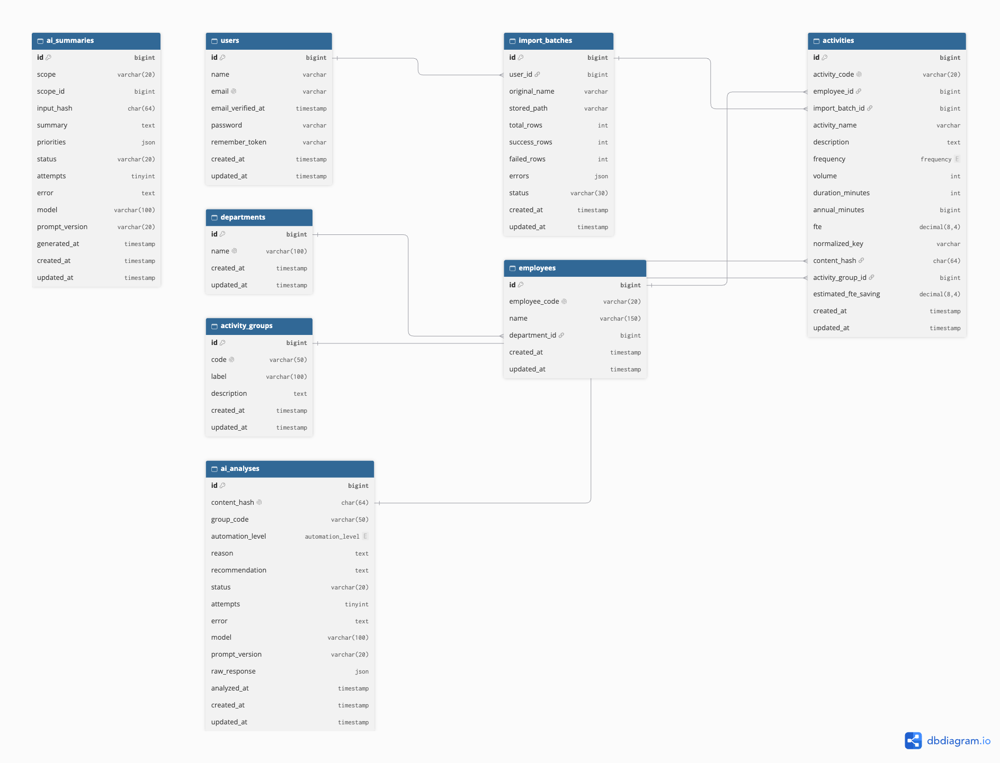

# Workload Assessment AI Insight — PT ABC

Aplikasi web untuk menganalisis hasil *workload assessment* karyawan: menghitung beban kerja (FTE), menilai potensi otomasi tiap aktivitas dengan AI, mengelompokkan aktivitas serupa lintas karyawan/departemen, dan menghasilkan kesimpulan serta prioritas otomasi.

> **Prinsip utama:** semua angka (FTE, saving, persentase, urutan prioritas) dihitung oleh kode secara deterministik. AI hanya dipakai untuk hal yang membutuhkan pemahaman makna teks: menilai level otomasi, menulis alasan & rekomendasi, mengelompokkan aktivitas serupa, dan menulis narasi kesimpulan.

---

## Daftar isi

1. [Fitur](#fitur)
2. [Tech stack](#tech-stack)
3. [Instalasi](#instalasi)
4. [Akun demo](#akun-demo)
5. [Cara pakai](#cara-pakai)
6. [Arsitektur](#arsitektur)
7. [Pembagian deterministik vs AI](#pembagian-deterministik-vs-ai)
8. [Perhitungan FTE & asumsi](#perhitungan-fte--asumsi)
9. [Kriteria level otomasi](#kriteria-level-otomasi)
10. [Konsistensi aktivitas serupa](#konsistensi-aktivitas-serupa)
11. [Cache, retry & penanganan kegagalan](#cache-retry--penanganan-kegagalan)
12. [Prompt AI](#prompt-ai)
13. [Database (ERD)](#database-erd)
14. [Format results.json](#format-resultsjson)
15. [Testing](#testing)
16. [Batasan & pengembangan lanjutan](#batasan--pengembangan-lanjutan)

---

## Fitur

- **Login** (Laravel starter kit, Fortify).
- **Import Excel** dengan validasi per baris (kolom wajib, enum frequency, angka positif, `activity_id` duplikat). Baris valid disimpan, baris invalid dilaporkan beserta nomor baris dan alasannya.
- **Perhitungan FTE** otomatis per aktivitas.
- **Analisis AI per aktivitas:** `automation_level` (high/medium/low), `reason`, `recommendation`.
- **Grouping aktivitas serupa** lintas karyawan & departemen ke dalam taksonomi tetap.
- **Kesimpulan AI** global, per departemen, dan per karyawan, beserta top-5 prioritas otomasi.
- **Dashboard:** total FTE, potensi saving, distribusi level, perbandingan departemen.
- **Progress analisis live**, tombol retry untuk yang gagal, dan analisis ulang tanpa cache.
- **Export** PDF, Excel (5 sheet), dan `results.json`.
- **Command CLI** untuk import, analisis, status, kesimpulan, dan export.

## Tech stack

| Bagian | Teknologi |
|---|---|
| Framework | Laravel 13 (PHP 8.3+) |
| UI | Livewire 4 (single-file components) + Flux UI + Tailwind CSS |
| Database | MySQL 8 |
| AI | Laravel AI SDK (`laravel/ai`) dengan provider **Google Gemini** |
| Queue | Laravel Queue (driver `database`) |
| Excel | `maatwebsite/excel` |
| PDF | `barryvdh/laravel-dompdf` |
| Chart | Chart.js |
| Test | Pest |

## Instalasi

### Prasyarat

- PHP 8.3+, Composer, Node.js 20+, MySQL 8
- API key Gemini dari [Google AI Studio](https://aistudio.google.com)

### Langkah

```bash
git clone https://github.com/Will-CJ/workload-ai workload-ai
cd workload-ai

composer install
npm install && npm run build

cp .env.example .env
php artisan key:generate
```

Buat database:

```sql
CREATE DATABASE workload_ai CHARACTER SET utf8mb4 COLLATE utf8mb4_unicode_ci;
```

Isi `.env`:

```dotenv
DB_CONNECTION=mysql
DB_HOST=127.0.0.1
DB_PORT=3306
DB_DATABASE=workload_ai
DB_USERNAME=root
DB_PASSWORD=

QUEUE_CONNECTION=database
DB_QUEUE_RETRY_AFTER=200

GEMINI_API_KEY=isi_api_key_anda
AI_PROVIDER=gemini
AI_MODEL=gemini-3.1-flash-lite
AI_TIMEOUT=60
AI_RATE_LIMIT_PER_MINUTE=10
AI_SIMULATE_FAILURE_RATE=0
AI_PROMPT_VERSION=v1
```

| Variabel | Keterangan |
|---|---|
| `AI_MODEL` | Model Gemini yang dipakai. Ganti jika model tidak tersedia di akun Anda. |
| `AI_RATE_LIMIT_PER_MINUTE` | Batas panggilan AI per menit. Sesuaikan dengan kuota akun. |
| `AI_SIMULATE_FAILURE_RATE` | 0–1. Untuk demo: `0.3` membuat ±30% panggilan AI sengaja gagal. |
| `AI_PROMPT_VERSION` | Versi file prompt di `resources/prompts`. Mengubahnya membuat cache tidak berlaku. |
| `DB_QUEUE_RETRY_AFTER` | Harus lebih besar dari timeout job (180 detik). |

Migrasi & seed:

```bash
php artisan migrate --seed
```

Jalankan aplikasi (Vite, queue worker, dan log sekaligus):

```bash
composer run dev
```

Atau, jika memakai Laravel Herd/Valet, cukup jalankan worker di terminal terpisah:

```bash
php artisan queue:work
```

> Queue worker **wajib** berjalan agar analisis AI diproses. Setelah mengubah `.env`, restart worker.

## Akun demo

| Email | Password |
|---|---|
| `admin@ptabc.test` | `password` |

## Cara pakai

### Lewat web

1. Login, buka **Import & Analisis**.
2. Upload `dataset/workload_assessment.xlsx`.
3. Klik **Jalankan analisis** dan tunggu progress mencapai 100% (diperbarui otomatis).
4. Lihat hasil di **Dashboard**, **Aktivitas**, **Grouping**, dan **Departemen & Karyawan**.
5. Unduh laporan di **Laporan & Export**.

`dataset/invalid_sample.xlsx` disediakan untuk mendemokan validasi import (semua barisnya sengaja invalid).

### Lewat terminal

```bash
php artisan workload:import dataset/workload_assessment.xlsx   # import + hitung FTE
php artisan workload:analyze                                   # analisis AI (pakai cache)
php artisan workload:analyze --force                           # analisis ulang tanpa cache
php artisan workload:status                                    # progress & error
php artisan workload:summarize                                 # buat ulang kesimpulan (jika angka berubah)
php artisan workload:export-results                            # tulis results.json di root project
```

## Arsitektur

Logika bisnis ditempatkan di **Service**, sehingga bisa dipakai oleh semua "pintu masuk": halaman Livewire, command CLI, job di queue, dan controller export.

```
Pintu masuk     Livewire pages · Artisan commands · Queue jobs · ExportController
                        │
Service         WorkloadImportService · FteCalculator · TextNormalizer
                AnalysisPipeline · AiClient · AiOutputValidator · PromptRepository
                MetricsService · SummaryService · ReportService · ResultsExporter
                        │
Data / AI       Eloquent models (MySQL)          AI agents + file prompt (Gemini)
                        │
Fondasi         config/workload.php · Enums · AppServiceProvider (rate limiter)
```

### Alur analisis

```
workload:analyze / tombol "Jalankan analisis"
  └─ AnalysisPipeline::run()
       1. hitung ulang content_hash setiap aktivitas
       2. satu baris ai_analyses per konten unik
       3. yang sudah success → disalin dari cache (tanpa AI)
       4. sisanya → GroupActivitiesJob
            └─ [AI] satu panggilan: pilih group_code dari taksonomi
            └─ batch AnalyzeActivityJob (satu per konten unik)
                 └─ [AI] level, reason, recommendation (+ contoh jangkar)
                 └─ validasi → simpan → hitung saving
            └─ setelah batch selesai → GenerateSummaryJob ×17
                 └─ [AI] narasi + alasan prioritas (angka dari MetricsService)
```

### Struktur folder penting

```
app/
├── Ai/Agents/            ActivityGrouper, ActivityAnalyzer, SummaryWriter
├── Console/Commands/     workload:* commands
├── Enums/                Frequency, AutomationLevel, AnalysisStatus, ...
├── Exports/              Excel export (WorkloadReportExport, ArraySheet)
├── Http/Controllers/     ExportController
├── Imports/              WorkloadImport
├── Jobs/                 GroupActivitiesJob, AnalyzeActivityJob, GenerateSummaryJob
├── Models/
└── Services/
config/workload.php       asumsi FTE, saving rate, pengaturan AI
resources/prompts/        file prompt AI (berversi)
resources/views/pages/    halaman Livewire
resources/views/reports/  template PDF
dataset/                  dataset Excel
docs/                     ERD
```

## Pembagian deterministik vs AI

| Komponen | Deterministik (kode) | AI |
|---|---|---|
| Import Excel | Validasi kolom, tipe, enum, duplikat; upsert data | — |
| FTE | Rumus tetap | — |
| Level otomasi | Validasi enum & schema output | Menilai level dari nama + deskripsi |
| Reason & recommendation | Validasi panjang & tidak kosong | Menulis teks |
| Grouping | Taksonomi tetap, validasi kode, fallback `other` | Memetakan aktivitas ke `group_code` |
| `estimated_fte_saving` | `fte × saving_rate[level]` | — (AI dilarang mengeluarkan angka) |
| Prioritas | Urutan: saving ↓, level ↓, FTE ↓, activity_id ↑ | — |
| Kesimpulan | Semua angka & daftar prioritas | Narasi dan alasan per prioritas |
| Dashboard, export | Seluruhnya | — |
| Cache, retry, validasi | Seluruhnya | — |

## Perhitungan FTE & asumsi

```
1 FTE              = 240 hari kerja × 480 menit = 115.200 menit/tahun
periode per tahun  = daily 240 · weekly 48 · monthly 12
annual_minutes     = duration_minutes × volume × periode per tahun
fte                = annual_minutes ÷ 115.200            (4 desimal)
estimated_fte_saving = fte × saving_rate[automation_level]
```

| Level | Saving rate |
|---|---|
| high | 70% |
| medium | 40% |
| low | 10% |

Contoh: aktivitas harian 14 × 5 menit → 16.800 menit/tahun → **0,1458 FTE**; dengan level high → saving **0,1021 FTE**.

**Asumsi:**

- `weekly = 48` diturunkan dari 240 hari kerja ÷ 5 hari per minggu, agar konsisten dengan basis 240 hari.
- Saving rate adalah asumsi bisnis (bagian waktu yang realistis bisa dihemat per level), disimpan di `config/workload.php` agar mudah diubah.
- Dataset hanya memuat aktivitas utama tiap karyawan, sehingga total FTE per karyawan di bawah 1.

## Kriteria level otomasi

| Level | Kriteria | Contoh |
|---|---|---|
| **High** | Berulang, berbasis aturan jelas, input/output terstruktur, hampir tanpa penilaian manusia | Input data ke sistem, rekap laporan rutin, rekonsiliasi, arsip dokumen |
| **Medium** | Sebagian bisa diotomasi, masih perlu verifikasi/pengecualian/keputusan manusia | Approval berbasis aturan, menjawab pertanyaan berulang, penjadwalan, screening awal |
| **Low** | Inti pekerjaan butuh penilaian, kreativitas, empati, negosiasi, atau tatap muka | Negosiasi, interview, coaching, rapat, presentasi klien |

Level dinilai dari **sifat pekerjaan**, bukan durasi atau frekuensinya.

## Konsistensi aktivitas serupa

Aktivitas serupa dijamin mendapat hasil yang konsisten melalui empat mekanisme:

1. **Deduplikasi konten.** Aktivitas dengan nama + deskripsi identik (setelah normalisasi) memiliki `content_hash` yang sama dan hanya dianalisis sekali; hasilnya dipakai bersama.
2. **Taksonomi grup tetap.** AI hanya boleh memilih `group_code` dari daftar enum (12 grup), sehingga aktivitas sejenis selalu jatuh ke grup yang sama. Grouping dilakukan dalam satu panggilan untuk semua aktivitas agar AI melihat konteks utuh.
3. **Contoh jangkar.** Saat menilai sebuah aktivitas, prompt menyertakan hingga 3 aktivitas dari grup yang sama yang sudah dinilai, dengan instruksi untuk memakai level yang sama jika sifatnya sama.
4. **Cache hasil.** Hasil yang sudah sukses disimpan; input yang sama selalu mengembalikan output yang sama tanpa memanggil AI lagi.

Output AI dibatasi dengan **structured output** (JSON schema dengan enum), lalu divalidasi ulang oleh `AiOutputValidator`.

## Cache, retry & penanganan kegagalan

| Mekanisme | Implementasi |
|---|---|
| **Cache analisis** | Tabel `ai_analyses`, key `content_hash = sha256(nama + deskripsi + versi prompt + model)`. Mengubah prompt atau model otomatis membuat cache tidak berlaku. |
| **Cache kesimpulan** | Tabel `ai_summaries`, key `input_hash` dari angka input. Kesimpulan hanya dibuat ulang jika angkanya berubah. |
| **Retry** | Job memakai `maxExceptions = 3` dengan backoff 10s, 30s, 90s untuk error API (timeout, rate limit, 5xx). |
| **Output tidak valid** | Satu kali permintaan koreksi ke AI; jika tetap tidak valid → status `failed` beserta pesan error dan raw response. |
| **Rate limit** | Job middleware `RateLimited('ai')` membatasi panggilan per menit; job yang tertahan dikembalikan ke antrian, bukan gagal. |
| **Status** | `pending` → `processing` → `success` / `failed`, terlihat di UI dan `workload:status`. |
| **Retry manual** | Tombol "Retry yang gagal" / `workload:analyze` hanya memproses yang belum `success`. |
| **Grouping gagal** | Analisis tetap berjalan; grup jatuh ke `other`. |
| **Guard duplikat** | Analisis baru ditolak selama analisis sebelumnya masih berjalan. |
| **Simulasi** | `AI_SIMULATE_FAILURE_RATE` untuk menguji jalur kegagalan. |

## Prompt AI

Prompt dipisahkan dari kode dan diberi versi:

```
resources/prompts/grouping.v1.md
resources/prompts/activity_analysis.v1.md
resources/prompts/summary.v1.md
```

`PromptRepository` membaca file sesuai `AI_PROMPT_VERSION` dan mengisi placeholder (mis. `{{groups}}`). Versi prompt dan model disimpan di setiap hasil analisis untuk keperluan audit.

## Database (ERD)



| Tabel | Isi |
|---|---|
| `departments`, `employees` | Master data dari import |
| `activities` | Data aktivitas + kolom hasil hitung (`annual_minutes`, `fte`, `content_hash`, `estimated_fte_saving`) |
| `activity_groups` | Taksonomi grup tetap (seeder) |
| `ai_analyses` | Hasil AI per konten unik (cache), status, attempts, error, raw response |
| `ai_summaries` | Kesimpulan AI per scope (global/department/employee) |
| `import_batches` | Riwayat import beserta error per baris |

## Format results.json

```json
[
  {
    "activity_id": "ACT-0001",
    "automation_level": "high",
    "reason": "…",
    "recommendation": "…",
    "group_id": "manual_data_entry",
    "fte": 0.1458,
    "estimated_fte_saving": 0.1021,
    "status": "success"
  }
]
```

Aktivitas yang gagal dianalisis tetap dicantumkan dengan `status: "failed"` dan field AI bernilai `null`. File dibuat dengan `php artisan workload:export-results` atau tombol di halaman Laporan & Export.

## Testing

```bash
php artisan test
```

Test memakai SQLite in-memory dan **fake AI agent**, sehingga tidak memanggil Gemini. Cakupan utama:

- Rumus FTE & saving (termasuk contoh dari soal)
- Import valid, import invalid, dan import ulang tanpa duplikasi
- Pipeline analisis & cache (AI tidak dipanggil ulang untuk konten yang sama)
- Kesimpulan: jumlah scope, urutan prioritas ditentukan sistem, cache `input_hash`
- Export: format results.json, download PDF/Excel/JSON
- Halaman dapat diakses setelah login

## Batasan & pengembangan lanjutan

- Gunakan **satu queue worker** agar contoh jangkar tersedia secara berurutan; worker paralel tetap aman tetapi konsistensi bisa sedikit menurun.
- Import memakai mode **partial** (baris valid tetap disimpan). Mode *all-or-nothing* dapat ditambahkan bila dibutuhkan.
- Saving rate per level adalah asumsi umum; idealnya dikalibrasi per jenis aktivitas.
- Rencana lanjutan: aplikasi mobile Flutter melalui API (Sanctum), peran pengguna (admin/viewer), dan riwayat versi hasil analisis.